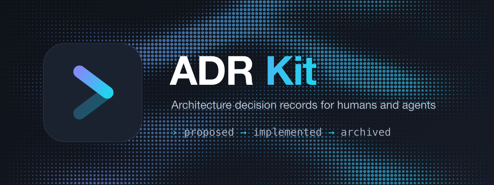
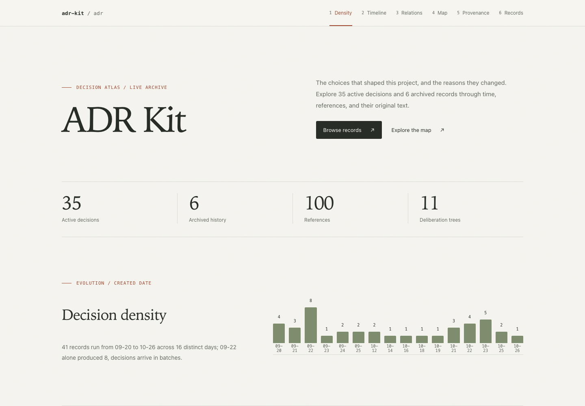
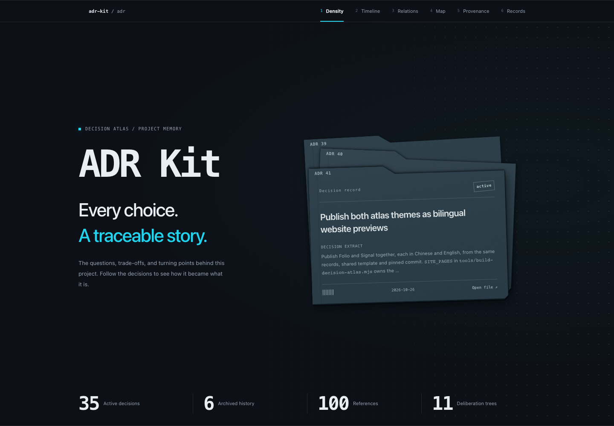

<div align="right">
  <a title="English" href="https://github.com/luochang212/adr-kit/blob/main/README.md"></a>
  <a title="简体中文" href="https://github.com/luochang212/adr-kit/blob/main/README.zh.md"></a>
</div>

# ADR Kit

<p>
  <a href="https://www.npmjs.com/package/adr-kit"></a>
  <a href="https://www.npmjs.com/package/adr-kit"></a>
  <a href="https://github.com/luochang212/adr-kit/blob/main/LICENSE"></a>
  <a href="https://zread.ai/luochang212/adr-kit"></a>
  <a href="https://github.com/luochang212/adr-kit/actions/workflows/ci.yml"></a>
</p>

<p>
  
</p>

ADR Kit stores architecture decisions as plain Markdown across four lifecycle directories. It is an independent, agent-friendly decision-record tool: proposals are unshipped, implemented records describe shipped choices, rejections keep the anti-patterns worth avoiding, and archives preserve frozen history.

- Plain Markdown and YAML front matter
- One choice per file, with explicit alternatives
- Stable ADR numbers assigned only when work ships
- Built for agents and humans

## Why record only key decisions?

Code and runtime results establish current behavior. Maintaining another document has a cost: it takes time and effort, and it can grow stale. A record earns its place only when its lasting benefit exceeds the cost of writing, reading, and maintaining it. That is why we record only key decisions.

Imagine making a fundamental, far-reaching decision on the project's first day. It may exist only in your head: why a boundary belongs here, or why you accept a limitation instead of choosing a seemingly easier alternative. Unless you capture those reasons, the code may preserve the outcome without explicitly preserving the intent.

Once the project reaches a hundred thousand lines, reconstructing that intent from the implementation becomes difficult. A new decision may conflict with the early choice, with no explicit record to reveal the constraint you need to consider. Two locally reasonable implementations can become inconsistent as a whole, causing bugs or creating conditions for recurring bugs.

ADRs preserve reasons that are hard to recover from code yet continue to shape future work. You or a later agent can then discover a conflict and judge whether the old constraint still holds. If it needs to change, you can explicitly replace it and adjust the affected implementation. Routine fixes, local renames, and implementation details already adequately explained by code and tests usually need no additional record.

## Quick start

Requires Node.js 22.22 or later. The npm package is `adr-kit`; the command it installs is `adrkit`.

```bash
npm install -g adr-kit
cd your-project
adrkit init
```

Initialization installs workflow skills into `.agents/`; use `adrkit init --tools claude` for additional `.claude/` copies. Read the installed `adrkit-init` skill and merge its "Reading architecture decisions" section into `AGENTS.md`, preserving existing project rules. The CLI leaves `AGENTS.md` for you to edit. See [Tell your agent](#tell-your-agent) for the ongoing workflow.

For an initialized project, use `adrkit update` when integrations need refreshing. On later sessions, start with `adrkit list` and read relevant decisions; setup does not need repeating. `adrkit instructions` shows the next workflow step and reminds you when installed integrations are missing their `AGENTS.md` rules.

```bash
adrkit propose "Use SQLite for session storage"
# Fill the proposal; after the work ships:
adrkit implement "Use SQLite for session storage" --raised-by human --decided-by human
adrkit validate
```

For an architectural choice already shipped, use `adrkit record "<title>" --raised-by human --decided-by human` instead. Mid-task, when a choice is worth capturing but not worth the record's shape yet, `adrkit note "<one line>"` parks a timestamped line in `adr/notes.md`. The line is outside the lifecycle, ignored by `adrkit validate`, counted by `adrkit list` and `adrkit instructions` until it is shaped or deleted.

```text
adr/
├── config.yaml
├── README.md
├── proposed/       # dated, unnumbered, unshipped
├── implemented/    # numbered, shipped, active guidance
├── rejected/       # dated, unnumbered, anti-patterns to avoid
└── archived/       # numbered, frozen history
```

An uncommitted proposal is a local working-tree draft; committing it shares it. There is no separate `.drafts/`. A choice settled by discussion remains proposed until shipped. `adrkit reject --reason` records a declined proposal's anti-pattern as a durable terminal: keep it, and remove it only when another record owns the warning it blocks. `adrkit supersede --by` archives a fully replaced implemented decision; `adrkit archive --reason` retires one whose current behavior has another authoritative owner. Never archive by age or quota. Partial replacement leaves still-relevant guidance active. Both moves write the archived record as ordinary Git-tracked history; there is no separate seal or manifest. `adrkit validate` checks it like any other record, and Git records later changes.

## Tell your agent

Agents over-focus on the current task and forget settled decisions; `adr/` is the memory against both. Add the [reading rule](docs/workflow.md#read-decisions-before-coding) to `AGENTS.md`. At task start, run `adrkit list`: read the relevant `implemented/` records in full, check `proposed/` for intent and `rejected/` for the bad cases they warn against, and consult `archived/` only for cited history. Do not filter by title alone. When a task targets specific files, `adrkit relevant <path>` retrieves the records whose `paths:` scopes govern them. The `adrkit-init` skill guides setup; `adrkit update` refreshes installed skills. Before creating a record, compare it with active records covering the same choice and link an unshipped replacement to the old decision, keeping that authority active until the replacement ships; resolve it with `adrkit supersede --by` in the delivery change; when shipping or reviewing, use the `adrkit-implement` and `adrkit-review` skills to keep realization facts aligned with shipped code. When code implements a decision, cite it in a comment with `@adr <number>`; `adrkit validate` fails when the citation is stale.


`adrkit show <name>` displays the complete main record without its optional `## Deliberation` appendix. Read the source file at the printed path when you need the original deliberation.

For a change already in progress, use `adrkit relevant --base <git-ref>` for the
exact base-to-working-tree change (including non-ignored untracked files), or
`adrkit relevant --staged` for the index only. These modes are exclusive with
explicit paths and preserve deleted paths and both rename endpoints. Incomplete
directory searches print diagnostics and exit non-zero. Scope coverage is never
exhaustive: active records without `paths` are counted, and `list` plus full
reading still apply. See the [retrieval contract](docs/cli.md#scope-retrieval-for-changes).

## Decision atlas

One offline HTML file brings together the decision map, numbered timeline, reference and supersession chains, and a searchable directory of every current and archived record, with full bodies. Both themes share these capabilities; no server or CDN is needed.

[Preview ADR Kit's atlas themes →](https://luochang212.github.io/adr-kit/decisions/en.html) Each atlas is rebuilt from this repository's `adr/` and pinned to the build commit. Both themes have live previews: click a theme name below to try it, or its screenshot to view the full image.

| Theme | Preview |
| :--- | :--- |
| **[Folio](https://luochang212.github.io/adr-kit/decisions/folio.en.html)** | [](./assets/decision-atlas-folio.png) |
| **[Signal](https://luochang212.github.io/adr-kit/decisions/signal.en.html)** | [](./assets/decision-atlas-signal.png) |

Without a specified theme, generation rolls Folio 30% / Signal 70% once — Signal is the flagship theme. An explicit theme request takes precedence; updates preserve an existing atlas's theme unless a change or fresh random choice is requested. Reloading the HTML keeps its theme.

```bash
adrkit atlas --out decisions.html
adrkit atlas --theme folio --out folio.html
adrkit atlas --theme signal --out signal.html
```

The interface defaults to English; add `--lang zh` for Chinese. Or ask your agent:

> Use the `adrkit-visualize` skill to build a browsable decision atlas from `adr/implemented/` and `adr/archived/`. Publish archived bodies in full, and pin the page to the current commit.

For a smaller view, use `adrkit atlas --map --format html` for the standalone decision map, or `adrkit atlas --record <N>` for one decision's deliberation tree. Themes apply only to the full atlas. See the [theme selection and shared behavior contract](docs/atlas-themes.md) for details.

## Commands

```text
adrkit init [path] [--tools <list>] [--workflows <list>]
adrkit propose <title>
adrkit note <text>
adrkit implement <name> --raised-by <human|agent> --decided-by <human|agent>
adrkit record <title> --raised-by <human|agent> --decided-by <human|agent>
adrkit reject <name> --reason <text>
adrkit archive <name> --reason <text>
adrkit supersede <old> --by <new>
adrkit list
adrkit relevant [<path>... | --base <git-ref> | --staged]
adrkit show <name>
adrkit status
adrkit instructions
adrkit validate [name] [--all]
adrkit update [--tools <list>] [--workflows <list>]
adrkit config
adrkit hook <install|uninstall|run>
adrkit atlas [--out <path>] [--map] [--lang <en|zh>] [--theme <folio|signal|random>] [--record <name>] [--format <mermaid|dot|text|html>] [--formal-only]
adrkit completion <bash|zsh|fish>
adrkit version
adrkit help
```

By default, integrations install into `.agents/`. Pass `--tools claude` for additional `.claude/` copies, or `--tools none` to install none. `--workflows` selects a subset such as `init,propose,implement,validate`.

`adrkit hook install` opts a clone into a pre-commit check: it blocks a staged record or `@adr` citation that is objectively invalid, and a staged deletion of a numbered decision (a rename that keeps the number still passes), then names the active decisions governing the staged files and asks for a record when the change settles one. `adrkit hook uninstall` removes only the hook adr-kit wrote; `git commit --no-verify` bypasses it once.

## Record format

Every record requires a one-sentence `description` explaining when to read it. The former `tags` field and `atlas --tag` filter are removed; maps use lifecycle styling. Existing records need an authored description, not a conversion of their old labels. See [upgrading](docs/upgrading.md).

A shipped decision is `adr/implemented/N-slug.md`:

```markdown
---
status: implemented
date: 2026-09-25
description: Read when changing session persistence or database deployment constraints.
raised-by: human
decided-by: human
created: 2026-09-24
---

# ADR: 1 Use SQLite for session storage

## Problem

...

## Decision

...

## Alternatives considered

...

## Consequences

...
```

Proposals use dated filenames and `Problem`, `Proposal`, `Alternatives considered`, `Acceptance criteria`, and `Risks`. The CLI stamps `date` on lifecycle moves; `created` preserves the birth date. `raised-by` and `decided-by` declare who introduced and settled a shipped choice, not who ran the command or authorized deployment. The CLI cannot verify shipping or provenance. `description` is a required single-line sentence explaining when to read the record; titles name the choice, and descriptions help agents discover its applicability. Optional `paths: [src/core/**]` scopes a record to the files it governs: repository-relative globs where `**` crosses directories, `*` stays within one segment, and `?` matches one character. `adrkit relevant <path>...` lists the records whose scopes govern a file or directory, grouped by lifecycle posture; records without `paths` never match, because scope retrieval is not full-text search. `adrkit validate` checks all four folders, rejects records outside them, and requires each entry's static directory anchor (or full literal path) to exist, so a rename fails validation instead of silently stranding the scope. A trailing slash is rejected too: `src/` would validate and then never match a file, so write `src/**` to scope a directory. Archived records are ordinary records too: the same format, path, and reference checks apply, and a later format migration is a normal Git commit. Fresh templates intentionally fail until filled.

`adrkit implement` folds a proposal's `## Acceptance criteria` and `## Risks` into present-tense `### Verification` and `### Trade-offs` under `## Consequences`; implemented records must not keep the old H3 names under Consequences. The command warns when it folds content because the CLI cannot rewrite prose. Amendments from later decisions collect in a `### Later changes` subsection at the end of Consequences, each entry opening `**Amended by ADR N:**`; `adrkit validate` enforces the form.

An implemented record may refresh factual paths, symbols, or defaults, but not rewrite the choice or rationale into another decision. A changed choice needs a new record and relationship. Full supersession stamps `superseded-by: N` and moves the old record to `archived/`. Archived records keep their numbers and are historical, not current authority. The decision map includes numbered history; `## Deliberation` optionally preserves the deliberation tree.

### Code cites the decision it follows

A code or configuration comment can point back at the decision it implements:

```ts
// @adr 14: paths must stay repository-relative
export function scope() { /* ... */ }
```

`adrkit validate` scans code and configuration files (not Markdown) for
`@adr <number>` and fails when the citation names a missing decision, one that
was superseded (naming the successor), or one that is archived, and when the
citing file sits outside that decision's `paths`. Citations are optional and
only the ones that exist are checked; the message names the line, so a stale
reference fails CI with the decision that replaced it. Record bodies
cross-reference decisions as `ADR-12`, `ADR 4`, or `ADR12`; a body reference
to a number that does not exist fails `adrkit validate --all`. The full
per-record and repository-wide check lists live in the
[CLI reference](docs/cli.md#validation-coverage).

See [record format](docs/record-format.md), [workflow](docs/workflow.md), and [CLI reference](docs/cli.md).

## Stability

ADR Kit is pre-stable and breaks on purpose: a release may change the record format or the command surface, and nothing promises forward compatibility. Records written by an older release are not guaranteed to keep passing validation, and not every break has a mechanical migration. Upgrading is the supported path: `adrkit update`, then `adrkit validate --all` in your repositories, where validation errors name what changed; archived records change only through a deliberate, explained commit. Per-release upgrade notes live in [the upgrade guide](docs/upgrading.md), and every change is listed in the [changelog](CHANGELOG.md).

## Sources of inspiration

[DeepSeek Harness Agent Notes](https://github.com/deepseek-ai/deepseek-harness) inspired the lifecycle directories and the distinction between proposed, implemented, rejected, and archived. ADR Kit keeps its own provenance fields, numbered decisions, validation, deliberation tree, and decision map. OpenSpec is not part of ADR Kit's runtime or governance model.

## Development

```bash
npm install
npm run typecheck
npm test
npm run build
```

Edit workflow text and descriptions in `src/core/tool-integrations.ts`, then run `npm run build` to regenerate the committed `skills/*/SKILL.md` files. Supporting resources remain hand-authored. See [skill sources](skills/README.md).

## License

MIT
