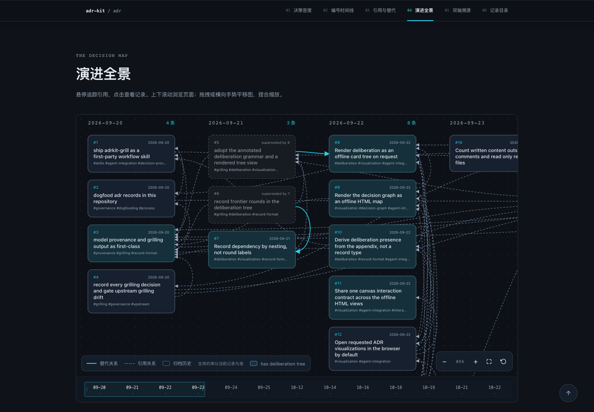

<div align="right">
  <a title="English" href="https://github.com/luochang212/adr-kit/blob/main/README.md"></a>
  <a title="简体中文" href="https://github.com/luochang212/adr-kit/blob/main/README.zh.md"></a>
</div>

# ADR Kit

<p>
  <a href="https://www.npmjs.com/package/adr-kit"></a>
  <a href="https://www.npmjs.com/package/adr-kit"></a>
  <a href="https://github.com/luochang212/adr-kit/blob/main/LICENSE"></a>
  <a href="https://zread.ai/luochang212/adr-kit"></a>
  <a href="https://github.com/luochang212/adr-kit/actions/workflows/ci.yml"></a>
</p>

<p>
  
</p>

ADR Kit 用纯 Markdown 记录架构决策，并以四个目录表示完整生命周期：`proposed/` 是未交付提案，`implemented/` 是已交付且仍有指导意义的决策，`rejected/` 保存待避免的反例（正式否决），`archived/` 保存最低价值的冻结历史。它是独立的、面向人与 agent 的决策记录工具。

- 纯 Markdown 与 YAML front matter
- 一个选择一个文件，含明确的备选
- 仅在工作交付时分配稳定 ADR 编号
- 面向 agent 与人类

## 为什么只记录关键决策

当前行为以代码和运行结果为准。但额外维护一份文档是有代价的：它需要时间和精力，也会逐渐过时。只有当一份记录长期带来的收益高于编写、阅读和维护它的成本时，它才值得存在。这就是为什么我们只记录关键决策。

想象项目第一天，你做了一个极为根本、影响很广的决策。当时它可能只存在于你的脑中：为什么要划这条边界，为什么宁愿接受一个限制，也不采用另一个看似更简单的方案。如果没有主动记录，代码可能留下选择的结果，却没有显式留下这些理由。

等项目长到十万行代码，再想从实现中猜回当初的意图就很麻烦了。此时，一个新决策可能和早期的选择冲突，却没有一处明确的记录提醒你：这里曾经有一个需要考虑的约束。两个局部合理的实现可能因此变得整体不一致，造成 bug，甚至成为反复产生 bug 的温床。

ADR 保留的是这些难以从代码中还原、却会持续影响未来工作的理由。后来的你或 agent 才能发现冲突，判断旧约束是否仍然成立；如果需要改变，也能明确替换它，并调整受影响的实现。普通修复、局部重命名，以及代码和测试已经充分说明的实现细节，通常无需额外记录。

## 快速开始

需要 Node.js 22.22 或更新版本。

```bash
npm install -g adr-kit
cd your-project
adrkit init
adrkit propose "使用 SQLite 存储会话"
# 填写提案，实际交付后：
adrkit implement "使用 SQLite 存储会话" --raised-by human --decided-by human
adrkit validate
```

已交付但尚未记录的选择可直接用 `adrkit record "<标题>" --raised-by human --decided-by human`。任务进行中遇到值得先记下、但还不值得展开成记录形态的选择时，`adrkit note "<一行>"` 把带时间戳的一行写进 `adr/notes.md`。这一行在生命周期之外，`adrkit validate` 忽略它，`adrkit list` 和 `adrkit instructions` 会计数显示，直到它被成形或删除。

```text
adr/
├── config.yaml
├── README.md
├── proposed/       # 按日期命名，未编号，尚未交付
├── implemented/    # 已编号、已交付，当前指导
├── rejected/       # 按日期命名，待避免的反例
└── archived/       # 保留编号，冻结历史
```

未提交的提案只是本地工作树草稿；Git 提交后成为共享提案，不另设 `.drafts/`。讨论已定方向但尚未交付时仍在 `proposed/`。正式否决用 `adrkit reject --reason` 记为稳定的反例终态：保留它，只有当另一条记录接管了它挡住的错误时才移除（否决记录无编号，因此移除一条多余的否决不会腾出可复用的编号）。完整替代用 `adrkit supersede --by` 并自动归档旧记录；当现状已有其他权威来源、原决策不再指导未来时，可用 `adrkit archive --reason` 归档。不要按年龄或配额归档；部分替代仍保留有效的现行记录。两次转移都把归档记录当作普通的 Git 跟踪历史；既没有封存仪式，也没有单独的封存清单。`adrkit validate` 像检查其他记录一样检查它，后续修改由 Git 记录。

## 升级

ADR Kit 尚未稳定，且有意破坏：版本可能变更记录格式或命令面，不承诺前向兼容。旧版本写下的记录不保证继续通过校验，也不是每次破坏都有机械迁移方案。升级是受支持的路径：先运行 `adrkit update` 刷新已安装集成，再在仓库运行 `adrkit validate --all`，校验错误会指出变化所在。常设指令会让 agent 升级包、在变更可机械迁移时迁移未归档记录，并如实报告无法迁移的记录而不是硬改；归档记录只通过有意且说明原因的提交修改。0.23.0 及更早版本写下的 `adr/archived/MANIFEST.json` 已不再读取，直接删除即可。

`AGENTS.md` 中的该段归你所有：可选的代际标记 `<!-- adrkit: standing-orders <id> -->` 表示已与哪一代模板核对，不保证正文完全一致。允许翻译、缩写和本地修改；项目专属要求放在该段之外。旧标记会让 `init`、`update`、`list`、`instructions` 和 `relevant` 提示：先与当前 `adrkit-init` 模板比较、处理变化，再更新标记。无标记的段落现在保持安静，包括旧安装；核对后保留或添加当前标记，即可选择接收以后的模板变化提醒。缺少整段规则时，init/update 仍会给出独立提醒。

可视化的破坏性变更：`--record <name>` 选择的树现在默认输出 HTML，也支持 `--format html`；`--diagram` 已移除。`atlas` 的多余位置参数会报错，选记录请用 `--record <name>`。`atlas --format html` 现在输出完整档案；所有格式的地图导出都必须显式添加 `--map`，未选择地图或单条记录时使用非 HTML 格式会报错。可视化命令已收敛为一个：`adrkit atlas`（地图用 `--map --format html`，单条决策的树用 `--record <N>`）；`adrkit graph` 与 `adrkit tree` 已移除。npm 包名是 `adr-kit`，CLI 命令是 `adrkit`（npm 上没有 `adrkit` 包）。CLI 需要 Node.js 22.22 或更新版本；更早的 Node.js 版本不再受支持。

## 告诉 Agent

Agent 会过度聚焦手头任务、遗忘已定的决策；`adr/` 正是对这两者的记忆。将[任务开始阅读规则](docs/zh/workflow.md#任务开始前阅读决策)加入 `AGENTS.md`。任务开始时先运行 `adrkit list`。四个目录是一份上下文预算：完整阅读相关的 `implemented/`；检查 `proposed/` 的意图与 `rejected/` 的反例；`archived/` 仅在任务明确引用历史时读。不能只看标题判断相关性。任务涉及具体文件时，`adrkit relevant <path>` 检索通过 `paths:` 限定管辖它们的记录。`adrkit-init` 指导配置，`adrkit update` 刷新已安装技能。创建记录前，先与涉及同一选择的现行记录比较，未交付的完整替代先链接意图并保留旧权威，交付时在同次变更中用 `adrkit supersede --by` 解析；交付或审查时用 `adrkit-implement` 和 `adrkit-review` 技能保持实现事实与已交付代码一致。代码实现某条决策时，在注释里用 `@adr <编号>` 引用它；引用失效会让 `adrkit validate` 失败。


实际变更可用 `adrkit relevant --base <git-ref>` 检索指定提交到工作区的变化
（含未忽略的未跟踪文件），或用 `adrkit relevant --staged` 只看暂存区。
三种输入互斥，保留删除与重命名的新旧路径。目录搜索不完整会输出诊断并以非零退出。
范围命中不等于完整上下文：没有 `paths` 的现行记录会提示数量，仍需 `list`
与完整阅读。详见[检索合同](docs/zh/cli.md#按变更检索决策)。

## 决策档案

一个页面就能承载整个归档：按创建日期分组的决策地图、编号时间线、引用与替代关系链，以及可本地搜索的全部生效与归档记录。档案是单个自包含的 HTML 文件，不需要服务器，也不依赖 CDN，可以离线使用。

[打开 ADR Kit 自己的决策档案](https://luochang212.github.io/adr-kit/decisions/)。它在每次站点构建时从本仓库的 `adr/` 重新生成，并固定到构建提交。

[](https://luochang212.github.io/adr-kit/decisions/)

为自己的仓库生成一份，把这句话交给 agent：

> 使用 `adrkit-visualize` 技能，从 `adr/implemented/` 与 `adr/archived/` 生成本仓库可浏览的决策档案。归档正文全文展示，并把页面固定到当前提交。

档案是默认可视化：`adrkit atlas --out decisions.html`。CLI 的命令输出与错误信息只有英文；档案界面默认英文，中文用 `--lang zh`。轻量入口仍然保留：`adrkit atlas --map --format html` 出独立的地图页，`adrkit atlas --record <N>` 看单条决策的 deliberation tree。

## 命令

```text
adrkit init [path] [--tools <list>] [--workflows <list>]
adrkit propose <title>
adrkit note <text>
adrkit implement <name> --raised-by <human|agent> --decided-by <human|agent>
adrkit record <title> --raised-by <human|agent> --decided-by <human|agent>
adrkit reject <name> --reason <text>
adrkit archive <name> --reason <text>
adrkit supersede <old> --by <new>
adrkit list
adrkit relevant [<path>... | --base <git-ref> | --staged]
adrkit show <name>
adrkit status
adrkit instructions
adrkit validate [name] [--all]
adrkit update [--tools <list>] [--workflows <list>]
adrkit config
adrkit hook <install|uninstall|run>
adrkit atlas [--out <path>] [--map] [--lang <en|zh>] [--record <name>] [--format <mermaid|dot|text|html>] [--tag <tag>] [--formal-only]
adrkit completion <bash|zsh|fish>
adrkit version
adrkit help
```

默认把集成安装到 `.agents/`；`--tools claude` 另装 `.claude/`，`--tools none` 不安装。可用 `--workflows init,propose,implement,validate` 选子集。

`adrkit hook install` 让当前克隆选择启用 pre-commit 检查：暂存记录或 `@adr` 引用存在客观错误时拦下提交，否则列出管辖这些改动的生效决策，并在改动定下选择时提醒写记录。`adrkit hook uninstall` 只移除 adr-kit 写入的钩子；`git commit --no-verify` 可单次绕过。

## 记录格式

已交付决策在 `adr/implemented/N-slug.md`：

```markdown
---
status: implemented
date: 2026-09-25
raised-by: human
decided-by: human
created: 2026-09-24
tags: [storage]
---

# ADR: 1 使用 SQLite 存储会话

## Problem

...

## Decision

...

## Alternatives considered

...

## Consequences

...
```

提案按日期命名，使用 `Problem`、`Proposal`、`Alternatives considered`、`Acceptance criteria`、`Risks`。`date` 在每次生命周期转移时由 CLI 写入；`created` 保留创建日期。`raised-by` 与 `decided-by` 分别声明谁提出、谁定下已交付选择，不表示谁运行命令或批准部署。CLI 不能验证交付或来源。`tags` 提供主题分类，不额外引入类别目录。可选 `paths: [src/core/**]` 把记录限定到它管辖的文件：仓库相对路径 glob，`**` 跨目录、`*` 不跨目录、`?` 匹配单字符。`adrkit relevant <path>...` 按阅读姿态列出管辖某文件或目录的记录；范围检索不是全文搜索，没有 `paths` 的记录永不匹配。`adrkit validate` 检查全部四个目录、拒绝目录之外的记录，并要求每个条目的静态目录锚点（无通配符时为完整路径）存在，重命名后校验会失败，范围不会悄悄悬空。归档记录也是普通记录：同样适用格式、路径与引用校验，之后的格式迁移就是一次普通的 Git 提交。新模板未填完时按预期失败。

`adrkit implement` 会把提案的 `## Acceptance criteria` 与 `## Risks` 折叠为 `## Consequences` 下的现在时 `### Verification` 与 `### Trade-offs`；implemented 记录不得在 Consequences 下保留旧 H3 标题。CLI 不能改写正文，因此折叠时会输出提醒。后续决策的修订收录在 `## Consequences` 末尾的 `### Later changes` 小节，每条以 `**Amended by ADR N:**` 开头；`adrkit validate` 校验该形式。

implemented 记录可以更新路径、符号、默认值等已交付事实，但不可悄悄重写选择或理由。选择改变应新建记录并建立关系。完整替代写入 `superseded-by: N`，旧记录移入 `archived/`；归档记录保持编号，只作历史参考。决策地图包含编号历史，可选 `## Deliberation` 附录保留 deliberation tree。

### 在代码中引用决策

代码或配置文件的注释可以指回它遵循的决策：

```ts
// @adr 14：路径必须保持仓库相对
export function scope() { /* ... */ }
```

`adrkit validate` 会扫描代码与配置文件（不扫描 Markdown）中的
`@adr <编号>`：记录不存在、已被替代（会报出替代者）、已归档，或引用文件不在该
记录的 `paths` 内时校验失败。引用是可选的，只检查已经写下的那些；报错会给出
行号，因此失效引用会让 CI 直接指出取代它的决策。记录正文之间用 `ADR-12`、
`ADR 4` 或 `ADR12` 互相引用；指向不存在编号的正文引用会让
`adrkit validate --all` 失败。逐条与整仓的完整检查清单见
[CLI 参考](docs/zh/cli.md#校验覆盖面)。

详见[记录格式](docs/zh/record-format.md)、[工作流](docs/zh/workflow.md)与[CLI 参考](docs/zh/cli.md)。

## 灵感来源

[DeepSeek Harness Agent Notes](https://github.com/deepseek-ai/deepseek-harness) 启发了生命周期目录及 proposed、implemented、rejected、archived 的语义。ADR Kit 保留自身的来源声明、稳定编号、校验、deliberation tree 和决策地图。OpenSpec 不是运行时或治理依赖。

## 开发

```bash
npm install
npm run typecheck
npm test
npm run build
```

## 许可证

MIT.
